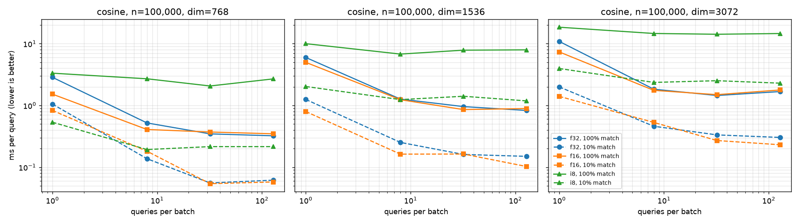
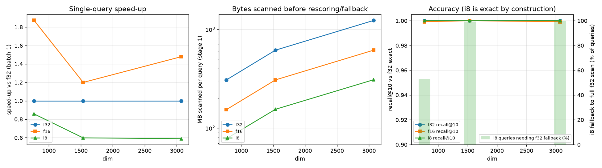
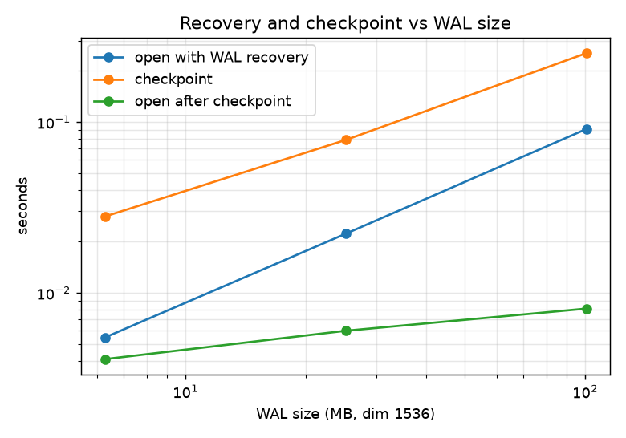
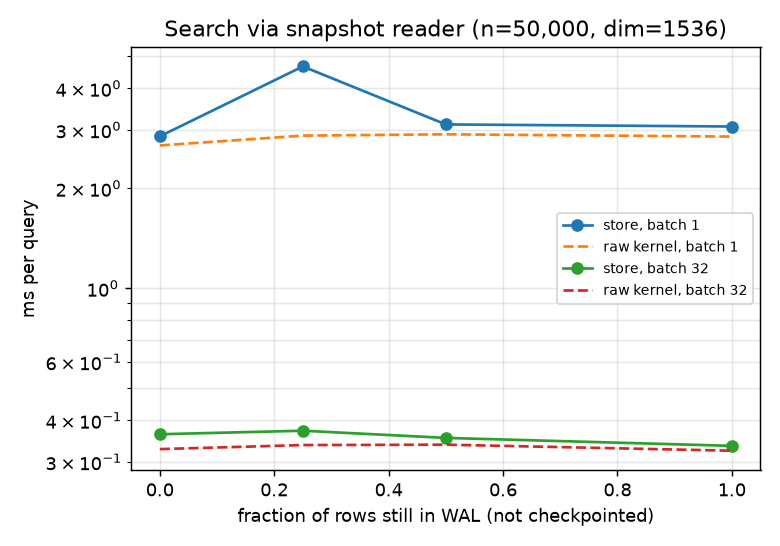
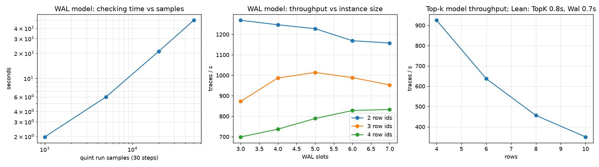

# vecdb spike: SQLite-style file-based vector search in Mojo

Throwaway spike. It checks whether Mojo can be the engine for an embeddable vector database: exact, batched search with per-query equality filters, stored in a main file plus a write-ahead log (`<db>` and `<db>-wal`, as in SQLite's WAL mode).

## Decisions

1. **Storage:** our own page-based format plus a write-ahead log (WAL). Not a SQLite extension.
2. **Index:** exact search only. See [Index decision](#index-decision).
3. **Filters:** equality on one tag per row, set per query (`tag == value`, or no filter). Deleted rows are skipped as a filter miss.
4. **Batching is built in.** Search takes `nq` queries. One query is `nq = 1`.
5. **Workload:** embeddings with 1536 dimensions or more.
6. **Storage type per collection:** float32 (default), float16 or int8, chosen when the file is created and stored in the header. Append and search still take float32. See [float16 and int8 storage](#float16-and-int8-storage).

## Index decision

- **Chosen: exact search.** Recall is always 1.0, there's nothing to build or tune, and filters can't reduce recall.
- **Why not HNSW:** it's a graph walk, so it doesn't vectorise or batch well. Strict filters also break its recall.
- **Later, if needed: IVF (clustered scan).** It reuses the same tiled kernel and filter path.
- **Before IVF, try smaller vectors.** A single query is limited by memory bandwidth, so float16, int8 or binary storage cuts its time directly.

## Embedding dimensions (research)

| Provider / model | Default dimensions | Can be truncated to (Matryoshka) |
|---|---|---|
| OpenAI text-embedding-3-small / -large | 1536 / 3072 | yes, via the `dimensions` parameter |
| Google gemini-embedding-001 / -2 | 3072 | recommends 768, 1536 or 3072 |
| Cohere embed-v5.0 / v4.0 | 2048 / 1536 | 256 to 2048 |
| Voyage 4 series | 1024 | 256, 512, 2048 |
| Qwen3-Embedding 0.6B / 4B / 8B | 1024 / 2560 / 4096 | 32 to 4096 |

Sources: the OpenAI, Gemini, Cohere and Voyage docs, and the Qwen3-Embedding-8B model card.

- Gemini's published MTEB scores barely change between 1536 and 768 dimensions (68.17 vs 67.99).
- Hugging Face reports that binary quantization with rescoring keeps about 96% of retrieval quality at 32x less memory (mxbai-embed-large, 1024 dimensions).

### Where dimension, batching and the GPU meet

- **Time tracks bytes read, not dimension.** 500k x 1536 and 250k x 3072 are the same 3.07 GB, and both took 24.7 ms per single query.
- **One query is limited by memory bandwidth** (about 117 GB/s on the M2 Pro), whatever the dimension. A GPU sharing that memory can't do better than about 1.6x.
- **A batch reuses every row it reads across all its queries,** so the work becomes limited by arithmetic. That's where accelerators pay off.
- On this Mac, Apple's Accelerate library reaches the AMX matrix unit (about 2.2 TFLOP/s measured through NumPy). Mojo can't. The Mojo NEON kernel plateaus around 480 GFLOP/s.
- The Apple GPU needs full Xcode (`xcrun metal`); this machine has the Command Line Tools only.

## Architecture

| Piece | File | Notes |
|---|---|---|
| Search kernel | `src/vdb.mojo` | Tiled 4 queries x 4 rows with explicit `fma`; per-chunk, per-query bounded top-k; per-query filters; `parallelize` over chunks |
| Storage engine | `src/store.mojo` | Main file, WAL, snapshot readers, checkpoint, recovery, simulated disk for crash tests |
| C headers | `include/vdb.h`, `include/vdb_store.h` | |
| Build | `build.sh` | Concatenates both modules so every `@export` is emitted |

### On-disk format

- **Main file:**
  - Two 4 KB header slots (magic, version, dim, extent rows, rows, checkpointed transaction, sequence number, checksum). The newest valid slot wins, so a torn header write falls back to the previous one.
  - Then fixed-size extents, each holding `[vectors][tags][live bytes]`, so every extent can be handed straight to the kernel.
- **WAL:**
  - A 64-byte header holds the salt.
  - Each frame has a 64-byte header (transaction, kind, commit flag, row id, tag, salt, chained checksum) followed by the vector.
  - The chained checksum is a 64-bit hash of (previous frame's checksum, this header, this payload), seeded by the salt.

### Operations

- **Commit:** writes all of a transaction's frames in one `pwrite`, runs `F_FULLFSYNC`, then publishes the transaction to new readers.
- **Snapshot readers:** each reader records (mark, salt, max slot) when it begins. Its view is the main file plus its visible WAL frames, replayed in order.
- **Checkpoint:**
  1. Applies transactions in (checkpointed, target], where target = min(published, every reader's mark).
  2. Syncs the data, writes the header, syncs again.
  3. Restarts the WAL with a new salt, syncing the new WAL header before any new frame. It only restarts when everything is checkpointed and every reader is current.
- **Recovery (open):**
  1. Picks the newest valid main header.
  2. Scans WAL frames while the salt, chain and checksum hold, and takes everything up to the last commit frame.
  3. Validates each frame's contents (kinds, ids, finite vectors, and that a re-appended row matches the main file).
  4. Replays the frames, then truncates and syncs the WAL past the recovered prefix.

## float16 and int8 storage

### What it is

- **One setting at create time** (`storage` in `vdb_open`; `-1` accepts whatever an existing file has). Inserts and queries stay float32, and the library converts on insert.
- **WAL records keep the float32 vectors.** Converting them is a pure function, so recovery and checkpoint re-derive identical bytes, and the WAL model is unchanged.
- **float16:**
  - Values beyond ±65,504 are rejected (`E_RANGE`).
  - Search converts to float32 and runs the same tiled kernel and `fma` chain, so results are exact for the stored float16 vectors.
- **int8, exact through rescoring:**
  - Each row gets one scale (its largest value / 127). Per row, the file also stores the float32 originals and (scale, ‖x‖², ‖x − x̂‖).
  - Stage 1 scans the int8 rows. For each row it computes an approximate score A and a rigorous error bound ε, keeping the top-k upper bounds (A + ε) and the lowest-M lower bounds (A − ε), with M = max(64, 4k).
  - τ = the largest of the k best upper bounds. The candidates are the rows whose lower bound is ≤ τ.
  - Each candidate is rescored with the float32 kernel. If the candidate buffer overflows, the query falls back to a full float32 scan.
  - The result is bit-identical to float32 search.

### Lean, `formal/lean/TopK.lean` (Rescore section)

No `sorry`. Axioms: `propext`, `Quot.sound` and `Classical.choice` (from library lemmas).

| Theorem | States | Why |
|---|---|---|
| `count_below_take` | In a sorted list, an element in the first k has fewer than k elements strictly below it | Base fact behind "rows outside the band can't be in the top-k". |
| `isort_filter`, `take_filter_of_all` | Sorting commutes with filtering, and filtering that keeps all of the top-k leaves the top-k unchanged | Rescoring a subset gives the full answer if the subset contains the true top-k. |
| `rescore_exact` | If every row's exact score lies in [lo, up], and τ has at least k rows with up ≤ τ (or every lo ≤ τ), then the top-k of {lo ≤ τ} equals the top-k of all rows | The core exactness argument. |
| `tau_valid` | τ = max of the k smallest upper bounds satisfies the τ condition | The code computes τ exactly this way (bounded top-k on upper bounds, merged with `bstep`; `topk_correct` covers the chunked merge). |
| `candidates_complete` | If the lowest-M lower-bound buffer isn't full, or holds an entry above τ, every row with lo ≤ τ is in it | The overflow rule: if neither holds, fall back to a full float32 scan. |
| `int8_search_exact` | The above combined: rescoring buffer members with lo ≤ τ gives exactly the float32 top-k | The algorithm as implemented. |
| `candidate_order_free` | Rescoring candidates in any order (distinct ids) gives the same top-k | The code visits candidates in lower-bound order, not row order. |
| Mutants: τ from lower bounds; overflow test allowing a full buffer | Must fail to prove | The proof depends on both rules. |

**Quint:** not used for this part. It's a single-threaded algorithm, which Lean covers for all sizes, and the WAL/reader model is unchanged because the WAL keeps float32.

**Not in Lean, checked by tests instead:** that the computed ε really bounds |A − S| in floating point. The bound is:

- Cauchy–Schwarz for the quantization term ‖q‖·‖x − x̂‖.
- γ(d) = (d+2)u / (1 − (d+2)u) for both `fma` chains, plus the rounding of the final combine for each metric.
- Evaluated in float64, then inflated by 0.1%.

### How the code conforms

| Formal | Code |
|---|---|
| lo ≤ score ≤ up | `eps_bound` in `src/vdb.mojo`; `dtype_test` checks \|A − S\| ≤ ε for every row and query (1.48M checks, worst ratio 0.999 of the bound) |
| τ = max of the k best upper bounds | Merged upper-bound buffer per query, then `max` |
| `candidates_complete` overflow rule | `overflow = nl == mcap and lo_max <= tau`, then fallback |
| Exact rescoring with the float32 kernel | `exact_score_m` uses `dots[1,1]`; the same lane-wise `fma` chain makes scores bit-identical to float32 search |
| Mutants | `VDB_MUTANT_NO_EPS`, `TAU_FROM_LOW`, `NO_FALLBACK`: each produces wrong top-k results in `dtype_test` |

Storage tests run the full crash/recovery/reader suite (29M checks) for each storage type. Other checks:

- Re-appends must match the main file's stored bytes (for int8, the encoded vector and the originals).
- Header dtype mismatch returns `E_DTYPE`.
- float16 out-of-range values are rejected on append.

### Results (100k rows, cosine, normalised low-rank + noise embeddings, k = 10)





| dim | f32 batch 1 | f16 batch 1 | i8 batch 1 | f32 batch 32 | f16 batch 32 | i8 batch 32 | f16 recall@10 vs f32 |
|---|---|---|---|---|---|---|---|
| 768 | 2.85 ms | 1.52 | 3.33 | 0.35 | 0.37 | 2.07 | 0.9992 |
| 1536 | 5.98 | 4.98 | 10.0 | 0.96 | 0.86 | 7.85 | 1.0 |
| 3072 | 10.9 | 7.36 | 18.5 | 1.45 | 1.49 | 14.2 | 0.9992 |

- **float16:**
  - Half the file size, 1.2–1.9x faster for single queries (it reads half the bytes), and no gain for batches (they're compute-bound and the conversion costs cycles).
  - Recall against float32 is 0.999–1.0. Results are exact for the stored float16 vectors.
- **int8 exact: slower than float32 on realistic embeddings.** Two reasons, both measured:
  1. **The rigorous bound is far too loose for normalised high-dimensional vectors.**
     - Cauchy–Schwarz charges ‖q‖·‖x − x̂‖ ≈ 0.008, but the real error |q·(x − x̂)| is about 1e-4: 41x smaller at dim 768 and 81x at dim 3072.
     - The gap between the 9th and 10th best score is about 3e-4–6e-4, so the ±ε band holds 45–175 rows even at n = 20k.
     - At n = 100k and dim ≥ 1536 the candidate buffer overflows on almost every query, and the full float32 fallback runs on top of the int8 scan.
  2. **The int8 kernel is compute-bound.** It converts int8 to float32 four lanes at a time, reaching about 24 GB/s against float32's 117 GB/s. A dot-product instruction on int8 (`SDOT`, with the query also quantized) is needed for int8 to be fast in any form.
  - On the store benchmark, int8 also makes the file 1.25x bigger (it keeps the originals) and ingest 20% slower.
- Where the bound is tight enough (dim 768, 10% filter), int8 exact is 2x faster than float32 for single queries (0.54 vs 1.05 ms), so the mechanism works. The bound is what fails at scale.

## Formal properties

### Quint: search, `formal/topk.qnt`

Batched queries, each with its own filter. Chunks finish in any order.

| Property | Enforces | Why |
|---|---|---|
| `resultIsExactTopK` | For every query, the result set equals the k smallest eligible (score, id) pairs | This is what exact search means. Catches candidates lost by per-chunk truncation, and filters applied in the wrong place. |
| `resultSortedUnique` | Results strictly ascending by (score, id) | Output is the same whatever order threads finish in. The id tie-break makes the order total. |
| `resultSizeIsMinKMatches` | Length = min(k, eligible rows) | No short results (the filter-after-top-k bug) and no padding. |
| `resultOnlyLiveAndMatching` | Every returned row is live and passes that query's own filter | Deleted rows never return, and one query's filter never leaks into another. |
| `localsBounded` | Each per-chunk, per-query buffer holds at most k entries | The code allocates exactly chunks x queries x k. |
| Witnesses | Truncation, ties and different filters are all reachable | The checks above aren't vacuous. |
| Mutants `NoTieBreak`, `PostFilter`, `LocalKMinusOne`, `QueryMix` | Each must violate an invariant | Each property catches its bug class. |

### Quint: file format and WAL, `formal/wal.qnt` + `formal/wal_test.qnt`

The model has one writer, two snapshot readers and a checkpointer. A crash can happen at any step. On a crash:

- Each unsynced WAL frame header and payload independently survives, is lost or is torn.
- The WAL salt, the main header and each main row independently survive or are lost.

| Property | Enforces | Why |
|---|---|---|
| `readerSnapshot` | Each active reader's view equals the committed state at its mark, even while commits, checkpoints and WAL restarts run | Snapshot isolation for readers. |
| `ackedDurable` | After any crash, recovered transactions ≥ acknowledged transactions | An acknowledged commit is never lost. |
| `recoveryAtomic` | The recovered state equals exactly the first N committed transactions, for the recovered N | No partial transactions, no resurrected deletes, no transaction recovered that the application saw abort. |
| `publishedOrder` | acked ≤ published ≤ committed, and the checkpoint header ≤ published | Acknowledge only after publishing; checkpoint only durable transactions. |
| Witnesses | A torn or mixed frame is recovered; a crash after a WAL restart; a reader behind a checkpoint; WAL replay over checkpointed rows | The dangerous situations really occur in the runs. |

Mutants, each a defence switched off:

| Mutant | Expected | Result |
|---|---|---|
| `AckBeforeSync` (acknowledge before `fsync`) | fail | `ackedDurable` violated |
| `CkptIgnoresReaders` | fail | `readerSnapshot` violated |
| `RestartEarly` (restart the WAL before the main header is durable) | fail | violated |
| `SkipDataSync` (header written before data is synced) | fail | violated |
| `UnsyncedRestartHdr` (new frames written before the new WAL header is durable) | fail | **Bug the model found.** An old WAL prefix is replayed onto a newer main file and brings back a deleted row. Random search found it at 100k–300k samples; a directed run in `wal_test.qnt` reproduces it every time. |
| `NoRecoveryTruncate` (recovery leaves stale bytes after the recovered prefix) | fail | **Bug the code tests found.** A later write with identical payload bytes completes an old torn frame, so a transaction that recovery had dropped comes back. Fixed by truncating and syncing the WAL during recovery. Directed run in `wal_test.qnt`. |
| `NoChain`, `ReaderNoSlotBound` | pass | Once recovery truncates, these defences are redundant in the model (300k samples, no violation). The code keeps the chain as defence in depth, and the code-level `NO_CHAIN` mutant also passes 29M checks. |

### Lean: `formal/lean/TopK.lean`

No `sorry`; the only axioms are `propext` and `Quot.sound`.

| Theorem | States | Why |
|---|---|---|
| `TotalOrd` (assumption) | (score, id) is a total order | The reason the code rejects NaN and infinite values and keeps row ids unique. |
| `topk_correct` | For any chunking and merge order, merging per-chunk bounded top-k equals "sort the filtered rows, take k" | Per-chunk buffers of size k are enough, and `parallelize` order doesn't matter. Also covers merging across storage extents. |
| `fused_fold`, `batch_correct` | One pass over rows that updates every query's buffer gives each query its single-query answer | Batching is correct. |
| `topk_unique`, `topk_length`, `topk_matches`, `topk_sorted` | The specification has one answer, with the right size, filter and order | The Quint properties, proved for every size. |
| Mutant (k−1 buffer) | Must fail to prove | The proof depends on the buffer size. |

### Lean: `formal/lean/Wal.lean`

| Theorem | States | Why |
|---|---|---|
| `replay_pointwise` | Replaying operations acts row by row | Lets the proofs reason about one row at a time. |
| `fold_idem`, `prefix_idem` | Replaying a sequence twice equals replaying it once; replaying from any prefix's state equals replaying from scratch | The operation algebra (append sets a row, delete clears its live flag) is idempotent. |
| `replay_from_prefix_state`, `overlay_idem` | If each row of the starting state equals the state after some prefix of W, replaying W gives the right state | Readers and recovery may safely replay frames already checkpointed. |
| `partial_checkpoint` | A main file whose rows are a per-row mix of before and after a checkpoint, plus a full WAL replay, gives the right state | A crash part-way through checkpoint writes is safe. |
| `stale_prefix_unsafe` | Replaying a strict prefix onto a newer state can be wrong (concrete counterexample) | The `UnsyncedRestartHdr` bug, stated formally. |
| `recover_atomic` | Recovered frames are a prefix of the written frames and end at a commit | Atomic recovery. |
| `recover_durable` | If the frames up to a synced commit are intact, recovery returns at least them | Durability. |
| Assumption `Agrees` | A frame passes its checks only if it is the frame written at that slot | Provided in code by the salt, the chained checksum and recovery truncation. The stale-frame bug broke exactly this assumption. |
| Mutant (delete toggles the live flag) | Must fail to prove | The proof depends on delete being idempotent. |

### How the code conforms

| Formal | Code |
|---|---|
| `bstep`, `cand_le`, chunk bounds, `mergeLocals` | Same definitions in `src/vdb.mojo`; extents are merged with `bstep` in `vdb_reader_search` |
| `writeFrameWith` + `syncWal` | `vdb_commit`: frames, one `pwrite`, `F_FULLFSYNC`, then publish |
| Reader (mark, salt, maxSlot), `view` | `vdb_reader_begin` and `make_view` |
| `ckptTarget`, `ckptApply` over (hdr, target], sync, header, sync | `ckpt_target`, `vdb_checkpoint` |
| `walRestart` + `syncWalHeader` before the first frame | Restart in `vdb_checkpoint` writes and syncs the new header |
| Atomic main header | Two header slots, sequence number and checksum |
| Crash with independent halves | Simulated disk: each 512-byte sector of an unsynced write is kept, written or torn |
| Recovery scan, last commit, replay, truncate | `recover_wal` |
| Invariants | `tests/store_test.c` checks `readerSnapshot`, `ackedDurable`, `recoveryAtomic` and `publishedOrder` after every step and every crash, and checks reader search against a reference |
| Mutants | `-D VDB_MUTANT_*`; `check_all.sh` requires each one to fail |

Not modelled, but tested in code:

- Frame content validation (kinds, ids, finite payloads, re-appends must match the main file).
- Dimension mismatch, corrupt headers, null and invalid arguments.
- A real-file round trip.

## Results

All graphs are in `results/graphs/`. Raw data is in `results/*.json`.

### Kernel: batch x dimension x filter selectivity (n = 100k, k = 10)


| dim | match | batch 1: Mojo / FAISS ms | batch 32 | batch 512 |
|---|---|---|---|---|
| 1536 | 100% | 5.66 / 12.0 | 0.67 / 3.78 | 0.76 / 0.26 |
| 1536 | 10% | 0.89 / 4.04 | 0.11 / 0.59 | 0.13 / 0.72 |
| 1536 | 1% | 0.29 / 0.35 | 0.028 / 0.053 | 0.025 / 0.045 |
| 3072 | 100% | 10.8 / 24.8 | 1.31 / 7.92 | 1.58 / 0.45 |
| 3072 | 10% | 1.73 / 6.75 | 0.27 / 1.43 | 0.29 / 1.07 |
| 3072 | 1% | 0.27 / 0.51 | 0.049 / 0.085 | 0.049 / 0.065 |

- Mojo wins every filtered case and every unfiltered case up to batch 32.
- FAISS (BLAS through Accelerate/AMX) wins unfiltered batches of 128 and more.

### Storage


- **Commit:**
  - Every commit pays one `F_FULLFSYNC`, about 4–5 ms on this SSD.
  - Throughput grows almost linearly with rows per commit: about 220 rows/s at 1 row per commit, 30k rows/s at 256, and 57k–85k rows/s at 1024 (705 MB/s at dim 3072).



- **Recovery on open:**
  - Replays the WAL at about 1.1 GB/s (91 ms for 100 MB).
  - Opening after a checkpoint takes 4–8 ms.
- **Checkpoint:** 225–400 MB/s, limited by per-row `pwrite` calls.



- **Search through a snapshot reader:**
  - Within about 3–10% of the raw kernel on the same rows, whether rows sit in the main file (memory-mapped) or only in the WAL. Single-query samples are noisy; one run measured 4.7 ms vs 2.9 ms.
  - Mapping the file on every search cost 3x at first. The mapping is now kept and only grown.

### Formal checking cost



- Quint random simulation of the WAL model runs at about 1,000 traces/s, so time grows linearly with samples (50k samples take 50 s).
- Throughput falls with more row ids, and barely changes with WAL slots.
- Each Lean file checks in under a second.

### Test volume

- `c_host`: 167,565 kernel checks under ASan and UBSan.
- `store_test`, 3,000 seeds x 200 steps: 29.2M checks with 0 failures, including:
  - 7,984 crashes in the middle of an operation and 24,065 crashes while idle;
  - 7,721 WAL restarts and 20,589 recoveries that replayed the WAL over checkpointed rows;
  - 4,853 unacknowledged transactions correctly lost, and 162k reader searches checked against a reference.
- Every kernel mutant and every storage mutant except `NO_CHAIN` is caught. `NO_CHAIN` passing is expected (see the WAL mutant table).

## Status

| # | Question | Verdict |
|---|---|---|
| S1 | Mojo C-ABI library with full validation | **VALIDATED** |
| S2a | Batched CPU exact search, competitive | **VALIDATED** (AMX through BLAS wins large unfiltered batches) |
| S2b | Apple GPU through Mojo | **BLOCKED**: needs full Xcode |
| S3 | Filtered batched top-k, formally verified | **VALIDATED** |
| S4 | File format + WAL: crash-safe, snapshot readers, formally modelled | **VALIDATED** within the limits below |
| S5a | float16 storage | **VALIDATED**: 2x smaller, up to 1.9x faster single-query, recall 0.999+ |
| S5b | int8 with provably exact rescoring | **INVALIDATED for performance**: correct and bit-identical, but the rigorous bound is 40–80x looser than real error on normalised embeddings, so it falls back to float32; the kernel also needs `SDOT` |

### Limits and gaps

- **Single process, single-threaded API.** Readers interleave with the writer but don't run on other threads. There is no multi-process locking or shared memory index yet.
- **Directory not synced.** The parent directory isn't `fsync`ed after the files are created.
- **Crash simulation assumes independence.** Sector independence is modelled; misdirected writes and bit rot are only partly covered, by checksums.
- **Checksum is not cryptographic.** It's a 64-bit hash, so `Agrees` holds with high probability, not with certainty.
- **Fixed-size frames.** Deletes carry an unused vector-sized payload.

### Surprises

- **ASAP destruction freed buffers too early.** Mojo frees a `List` after its last tracked use, so buffers passed to libc by address were freed before the call finished. The fix is `_ = buf^` keep-alives.
- **`@export` in an imported module is only emitted when it's called.** `build.sh` concatenates the modules instead.
- **Mapping per search tripled latency.** The mapping is now persistent.
- **Two real durability bugs were found:** one by the model, one by the code tests. Each now has a directed Quint run and a code mutant.

## Run

```
uv venv -p 3.12 .venv && source .venv/bin/activate
uv pip install mojo==1.2.0 max==26.7.0 numpy faiss-cpu matplotlib
./check_all.sh
python -I bench/bench_store.py && python -I bench/sweep_kernel.py 100000 && python -I bench/sweep_dtype.py 100000 && python -I bench/bench_formal.py && python -I bench/plots.py
```
