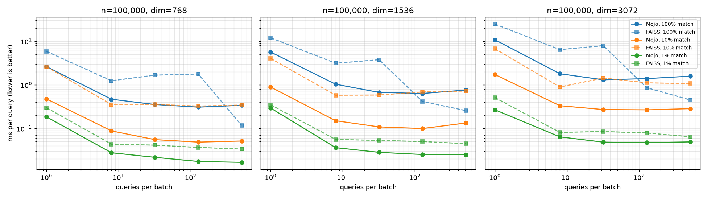
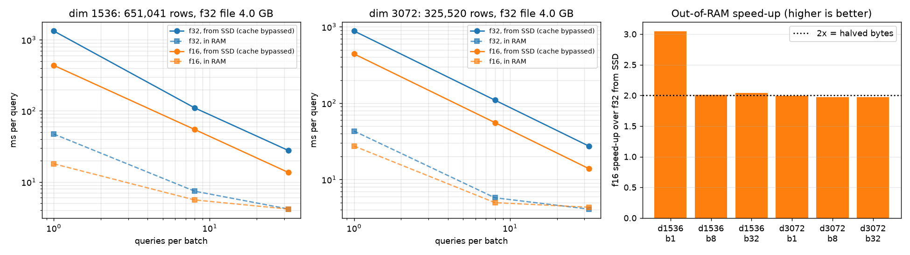

# veclite

An embeddable, file-based vector database in the spirit of SQLite: exact nearest-neighbour search with metadata filters, written in Mojo and exposed as a C library (`libveclite.so`) with Python bindings.

- **Exact search.** Recall is always 1.0. There is no index to build or tune, and filters never cost recall.
- **Your own keys.** Each row carries a 64-bit key you choose (for example, a document id), and search returns those keys.
- **Batched and filtered.** Each call takes many queries, each with its own tag filter. Rows that don't match are skipped, not scored.
- **Crash-safe single file + WAL.** SQLite-style write-ahead log with snapshot readers, checkpoints, and recovery from torn writes.
- **float32 or float16 storage**, chosen per collection.
- **GPU when it helps.** `device="auto"` (the default) sends large unfiltered batches to the GPU and everything else to the CPU, with the same exact results either way. `device="cpu"` or `"gpu"` forces one.
- **Verified.** The algorithms are modelled in Quint and proved in Lean. The code is checked against those models with crash-simulation tests and deliberately broken builds (see [docs/DESIGN.md](docs/DESIGN.md)).

## Why

Most vector stores use approximate indexes (HNSW, IVF) that trade recall for speed, and lose recall badly under selective filters. For embeddings of 1536 dimensions and up, a well-tuned exact scan is competitive:



*100k rows, k = 10. veclite (solid) vs FAISS flat (dashed), by batch size and filter selectivity. veclite is faster for every filtered query and for unfiltered batches up to about 32. FAISS (BLAS) wins large unfiltered batches.*

The scan is bound by memory bandwidth, so float16 storage halves both the file and the search time once a collection no longer fits in RAM:



## Use it from Python (Linux)

Build the library once (this produces `build/libveclite.so`):

```bash
python3 -m venv .venv && . .venv/bin/activate
pip install mojo==1.2.0 max==26.7.0 numpy
scripts/build.sh
export PYTHONPATH=$PWD/python
```

```python
import veclite

docs = {
    1001: {"tenant": 7, "text": "How to reset a password"},
    1002: {"tenant": 7, "text": "Billing cycles explained"},
    2001: {"tenant": 9, "text": "Configuring SSO with Okta"},
}

with veclite.open("docs.db", dim=1536) as db:
    keys = list(docs)
    db.add(embed([docs[k]["text"] for k in keys]), keys=keys, tags=[docs[k]["tenant"] for k in keys])

    hits, distances = db.search(embed(["forgot my login"])[0], k=2, tag=7)
    for key, dist in zip(hits, distances):
        print(key, dist, docs[key]["text"])

    docs[1002]["text"] = "Billing cycles and invoices explained"
    db.delete(1002, commit=False)
    db.add(embed([docs[1002]["text"]]), keys=[1002], tags=[7])
```

- `embed()` stands for your embedding model. veclite stores vectors, a 64-bit key you choose, and one 64-bit tag per row. The documents themselves stay wherever you keep them, here a dict.
- `search` returns your keys, so `docs[key]` is the matching document. With `tag=7` it searches only tenant 7, and a 2-D array of queries returns one result per query from a single call.
- Keys are unique among live rows. Adding a live key raises `VecliteError` (duplicate key) and writes nothing. To update a document, delete its key and add it again; with `commit=False` on the delete, both happen in one transaction.
- `add` and `delete` are durable when they return, and all-or-nothing: if any row is bad, nothing from that call is written, and `VecliteError.row` says which row. A `Database` is safe to share between threads.

[`examples/quickstart.py`](examples/quickstart.py) is a runnable version, executed by the test suite. `libveclite.so` links to the Mojo runtime in the environment it was built in, so load it from that same environment.

## Platforms and tests

- **Linux** (arm64 and x86-64; glibc ≥ 2.34) and **macOS** (Apple silicon). The full suite passes on all three. x86-64 is tested under emulation in Docker.
- GPU kernels run on Apple GPUs (Metal) today. Linux builds are CPU-only until the kernels are validated on NVIDIA/AMD; `device="auto"` just uses the CPU there.
- `scripts/check.sh` runs the C and Python test suites and checks that every deliberately broken build is caught.
- `scripts/check-linux.sh` runs the same suite in an Ubuntu 24.04 container.
- `scripts/check-formal.sh` runs the Quint models and Lean proofs.

## More

- [docs/DESIGN.md](docs/DESIGN.md): file format, WAL and recovery, formal property tables, GPU, float16/int8 findings, full benchmarks.
- `include/veclite.h`, `include/veclite_store.h`: the C API.

## Licence

Apache License 2.0. See [LICENSE](LICENSE) and [NOTICE](NOTICE).
