# veclite: design, formal properties and results

This document grew out of the original spike. It checks whether Mojo can be the engine for an embeddable vector database: exact, batched search with per-query equality filters, stored in a main file plus a write-ahead log (`<db>` and `<db>-wal`, as in SQLite's WAL mode).

## Decisions

1. **Storage:** our own page-based format plus a write-ahead log (WAL). Not a SQLite extension.
2. **Index:** exact search only. See [Index decision](#index-decision).
3. **Filters:** equality on one tag per row, set per query (`tag == value`, or no filter). Deleted rows are skipped as a filter miss.
4. **Batching is built in.** Search takes `nq` queries. One query is `nq = 1`.
5. **Workload:** embeddings with 1536 dimensions or more.
6. **Storage type per collection:** float32 (default) or float16, chosen when the file is created and stored in the header. Append and search still take float32. See [float16 storage](#float16-storage). int8 was tried and removed.

## Index decision

- **Chosen: exact search.** Recall is always 1.0, there's nothing to build or tune, and filters can't reduce recall.
- **Why not HNSW:** it's a graph walk, so it doesn't vectorise or batch well. Strict filters also break its recall.
- **Later, if needed: IVF (clustered scan).** It reuses the same tiled kernel and filter path.
- **Before IVF, try smaller vectors.** A single query is limited by memory bandwidth, so float16, int8 or binary storage cuts its time directly.

## Embedding dimensions (research)

| Provider / model | Default dimensions | Can be truncated to (Matryoshka) |
|---|---|---|
| OpenAI text-embedding-3-small / -large | 1536 / 3072 | yes, via the `dimensions` parameter |
| Google gemini-embedding-001 / -2 | 3072 | recommends 768, 1536 or 3072 |
| Cohere embed-v5.0 / v4.0 | 2048 / 1536 | 256 to 2048 |
| Voyage 4 series | 1024 | 256, 512, 2048 |
| Qwen3-Embedding 0.6B / 4B / 8B | 1024 / 2560 / 4096 | 32 to 4096 |

Sources: the OpenAI, Gemini, Cohere and Voyage docs, and the Qwen3-Embedding-8B model card.

- Gemini's published MTEB scores barely change between 1536 and 768 dimensions (68.17 vs 67.99).
- Hugging Face reports that binary quantization with rescoring keeps about 96% of retrieval quality at 32x less memory (mxbai-embed-large, 1024 dimensions).

### Where dimension, batching and the GPU meet

- **Time tracks bytes read, not dimension.** 500k x 1536 and 250k x 3072 are the same 3.07 GB, and both took 24.7 ms per single query.
- **One query is limited by memory bandwidth** (about 117 GB/s on the M2 Pro), whatever the dimension. A GPU sharing that memory can't do better than about 1.6x.
- **A batch reuses every row it reads across all its queries,** so the work becomes limited by arithmetic. That's where accelerators pay off.
- On this Mac, Apple's Accelerate library reaches the AMX matrix unit (about 2.2 TFLOP/s measured through NumPy). Mojo can't. The Mojo NEON kernel plateaus around 480 GFLOP/s.
- The Apple GPU needs full Xcode (`xcrun metal`); this machine has the Command Line Tools only.

## Architecture

| Piece | File | Notes |
|---|---|---|
| Search kernel | `src/kernel.mojo` | Tiled 4 queries x 4 rows with explicit `fma`; per-chunk, per-query bounded top-k; per-query filters; `parallelize` over chunks |
| Storage engine | `src/store.mojo` | Main file, WAL, snapshot readers, checkpoint, recovery, simulated disk for crash tests |
| C headers | `include/veclite.h`, `include/veclite_store.h` | |
| Build | `scripts/build.sh` | Concatenates both modules so every `@export` is emitted |

### On-disk format

- **Main file:**
  - Two 4 KB header slots (magic, version, dim, extent rows, rows, checkpointed transaction, sequence number, checksum). The newest valid slot wins, so a torn header write falls back to the previous one.
  - Then fixed-size extents, each holding `[vectors][tags][live bytes]`, so every extent can be handed straight to the kernel.
- **WAL:**
  - A 64-byte header holds the salt.
  - Each frame has a 64-byte header (transaction, kind, commit flag, row id, tag, salt, chained checksum) followed by the vector.
  - The chained checksum is a 64-bit hash of (previous frame's checksum, this header, this payload), seeded by the salt.

### Operations

- **Commit:** writes all of a transaction's frames in one `pwrite`, runs `F_FULLFSYNC`, then publishes the transaction to new readers.
- **Snapshot readers:** each reader records (mark, salt, max slot) when it begins. Its view is the main file plus its visible WAL frames, replayed in order.
- **Checkpoint:**
  1. Applies transactions in (checkpointed, target], where target = min(published, every reader's mark).
  2. Syncs the data, writes the header, syncs again.
  3. Restarts the WAL with a new salt, syncing the new WAL header before any new frame. It only restarts when everything is checkpointed and every reader is current.
- **Recovery (open):**
  1. Picks the newest valid main header.
  2. Scans WAL frames while the salt, chain and checksum hold, and takes everything up to the last commit frame.
  3. Validates each frame's contents (kinds, ids, finite vectors, and that a re-appended row matches the main file).
  4. Replays the frames, then truncates and syncs the WAL past the recovered prefix.

## float16 storage

### What it is

- **One setting at create time:** `storage` in `veclite_open` is `0` = float32 (default) or `1` = float16. `-1` accepts whatever an existing file has; a mismatch returns `E_DTYPE`.
- **Inserts and queries stay float32.** The library converts on insert and rejects values beyond ±65,504 (`E_RANGE`).
- **WAL records keep float32.** Converting is a pure function, so recovery and checkpoint re-derive identical bytes; the WAL model and proofs are unchanged.
- **Search** converts each float16 lane to float32 and runs the same tiled `fma` kernel. Results are exact for the stored float16 vectors and bit-identical to a float32 search over the decoded vectors (tested). They are not identical to float32 search over the originals.
- **Formal work:** none needed. The proofs treat the score function as given and the order as (score, id), and both still hold.

### Results

**In RAM** (100k rows, cosine, normalised embeddings, k = 10; ms per query):

| dim | f32 batch 1 | f16 batch 1 | f32 batch 32 | f16 batch 32 | f16 recall@10 vs f32 |
|---|---|---|---|---|---|
| 768 | 2.63 | 1.50 | 0.40 | 0.45 | 0.9992 |
| 1536 | 5.84 | 3.08 | 0.65 | 0.88 | 1.0 |
| 3072 | 10.6 | 7.77 | 1.26 | 1.84 | 0.9992 |

**From SSD, bigger than the cache** (4 GB of float32 per dimension; OS cache bypassed with `F_NOCACHE`; each file verified cold with `mincore` before and after timing; 64 MB double-buffered reads; streamed results asserted equal to in-RAM results):

| dim | batch | f32 ms/q | f16 ms/q | speed-up |
|---|---|---|---|---|
| 1536 | 1 | 1,002–1,330 | 437 | 2.3–3.0x |
| 1536 | 8 | 110 | 55 | 2.0x |
| 1536 | 32 | 27.7 | 13.6 | 2.0x |
| 3072 | 1 | 882 | 441 | 2.0x |
| 3072 | 8 | 109 | 56 | 2.0x |
| 3072 | 32 | 27.4 | 13.9 | 2.0x |

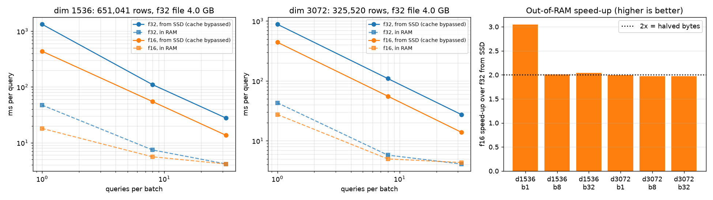
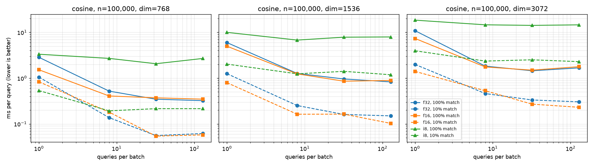
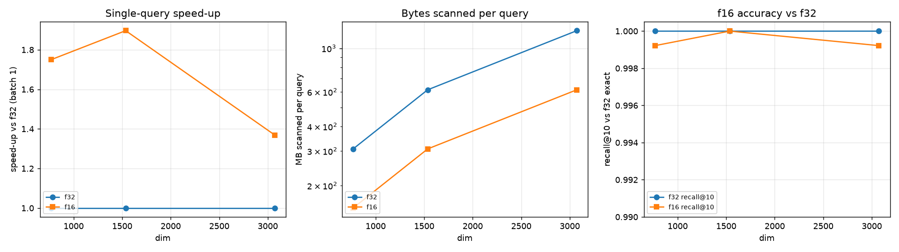
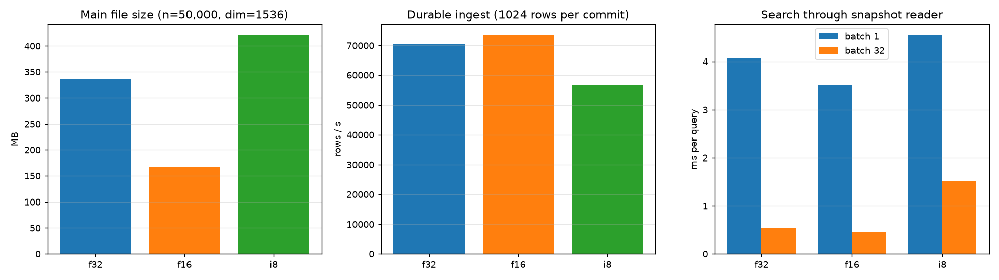

- **Out of RAM, float16 is a clean 2x faster at every batch size.** Both types read at the SSD's ~4.5 GB/s, so time is purely bytes read, and float16 reads half. The 1536/batch-1 float32 runs varied (1.0–1.3 s), so that 3x is partly noise; 2x is the result.
- **In RAM, single queries are 1.4–1.9x faster** (memory-bound). Batches of 32+ are 10–45% *slower* with float16: they are compute-bound and each lane pays a conversion.
- **Kernel tuning didn't help the conversion cost.** An unroll × tile sweep (raw data in `results/f16_unroll_sweep.jsonl`) found no variant beyond noise, so the kernel stays as is. The variable 1536-dimension speed-up seen earlier was run-to-run noise: this run gives 1.9x.
- **Storage:** the main file and memory footprint halve (336 → 168 MB at 50k × 1536), and ingest is about 20% faster. The WAL is unchanged.
- **Recommendation:** float32 by default. Choose float16 when the collection is near or beyond RAM, or when single-query latency matters more than batch throughput.

### int8: tried and removed

- int8 with **provably exact** rescoring was built, proved in Lean, and tested: bit-identical to float32 over 1.7M checks.
- It was slower than float32 on realistic embeddings, for two reasons:
  - **The bound is too loose.** The Cauchy–Schwarz error bound is 41–81x larger than the actual error, so candidate sets overflow and queries fall back to a float32 scan.
  - **The kernel is too slow.** Without `SDOT` the int8 scan runs at about 24 GB/s.
- Removed from `main`. The code, proof (`int8_search_exact`), tests and benchmarks are at tag [`int8-exact-experiment`](https://github.com/g15ecb/veclite/tree/int8-exact-experiment).
- Approximate int8 (rescore the top few multiples of k) would be fast but breaks the exact-search decision, so it wasn't pursued.

## GPU (Apple M2 Pro, Metal via Mojo)

### What it is

`src/gpu.mojo`, C API `veclite_gpu_open/update/search/close`:
- **Resident collection.** Vectors (float32 or float16), row norms, tags and live flags are copied to the GPU once. `veclite_gpu_update` refreshes tags and live flags after deletes.
- **Scoring:**
  - 1 query: a matrix-vector kernel where 32 threads read each row with 16-byte loads.
  - 2–16 queries: a 128-row × 16-query tile.
  - 17+ queries: a 128 × 64 tile with 8 × 4 results per thread.
  - All use precomputed load addresses and 32-bit index arithmetic.
- **Selection:** each chunk of 2,048 rows is handled by 32 threads holding 64 scores each in registers. The chunk's top-k is picked by repeatedly taking the next smallest (score, id), using shuffle reductions and no barriers. Filters are applied before selection.
- **Merge:** chunks are merged on the CPU with the proven `bstep` merge. Non-finite scores return `E_SCORE_NONFINITE`.

### Lean (`formal/lean/TopK.lean`)

| Theorem | States | Why |
|---|---|---|
| `isort_cons_min` | If m is in L and ≤ every element, `isort L = m :: isort (L.erase m)` | The step that makes "take the minimum" equal sorting. |
| `selectMin_spec` | Any selector that repeatedly picks a minimum of the remaining elements and removes it returns exactly `(isort L).take k` | Justifies the GPU's k-pass selection. With unique ids, "strictly after the last pick in (score, id) order" equals "remove the picked elements". |
| `gpu_chunks_correct` | If every chunk returns `(isort (chunk.filter p)).take k`, the CPU merge in any order equals the global top-k | Plugs the GPU chunks into `topk_correct`. |
| Mutant: the selector picks a maximum | Must fail to prove | The proof depends on the minimum property. |

No Quint model is needed: the kernels are deterministic per chunk, and the merge is already proved.

### Tests (`tests/c/gpu_test.c`)

- **Inputs:** integer-valued data, so float32 scores are exact and comparisons can be bit-for-bit.
- **Scores:** for L2 and dot product, every GPU score equals the CPU score, and GPU results equal CPU results.
- **Top-k:** for every metric, GPU top-k equals the specification (sort the GPU's scores by (score, id), filter, take k).
- **Coverage:** 1 to 13,000 rows (several chunks), ties, per-query filters, deletes via `veclite_gpu_update`, and float16.
- **Error paths:** NaN rows, and every invalid argument.
- **Totals:** 6.8M checks with no failures. All 3 GPU mutants are caught (no tie-break: 11,700 failures; k−1 per chunk: 2,038; filter after selection: 8,422).

### Results (100k rows, cosine, normalised embeddings, k = 10; ms per query)

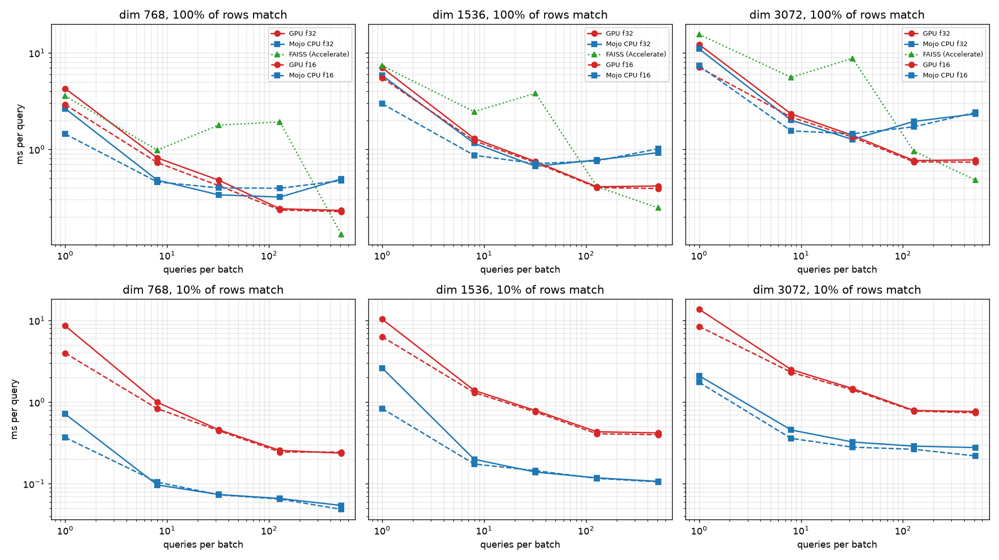
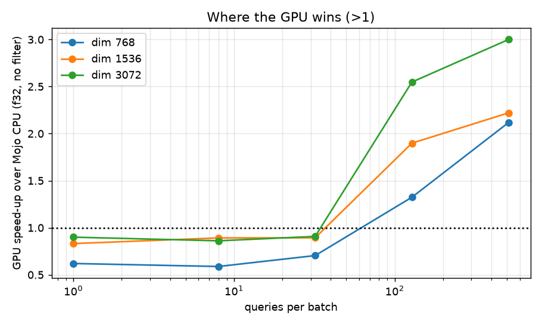

| dim | batch | GPU | Mojo CPU | FAISS (Accelerate) |
|---|---|---|---|---|
| 768 | 1 / 32 / 128 / 512 | 4.27 / 0.48 / 0.24 / 0.23 | 2.65 / 0.34 / 0.32 / 0.49 | 3.58 / 1.78 / 1.93 / 0.13 |
| 1536 | 1 / 32 / 128 / 512 | 7.01 / 0.75 / 0.41 / 0.42 | 5.83 / 0.67 / 0.78 / 0.92 | 7.36 / 3.81 / 0.41 / 0.25 |
| 3072 | 1 / 32 / 128 / 512 | 12.2 / 1.40 / 0.76 / 0.78 | 11.0 / 1.27 / 1.95 / 2.33 | 15.6 / 8.79 / 0.96 / 0.48 |

- **The GPU wins only on unfiltered batches of 128 or more:** 1.3–3x faster than the Mojo CPU, and the gap grows with dimension.
  - Below 128 it is 0.6–0.9x, because fixed per-call overhead and memory bandwidth dominate. The GPU shares the CPU's memory, so one query can't be faster.
- **FAISS (BLAS on the AMX unit) is still fastest at batch 512:** 0.48 vs 0.78 ms at dim 3072.
  - My scoring kernel reaches 0.88 TFLOP/s against a GPU peak of about 6.8 TFLOP/s (figure from memory).
  - Closing that gap needs Apple's simdgroup 8×8 matrix instructions, which I haven't tried.
- **Filtered searches are slower on the GPU at every batch size.** The GPU scores every row and filters at selection; the CPU skips non-matching rows. A GPU gather of matching rows would fix this.
- **float16 on the GPU:** no gain for batches, because they're compute-bound.
- **Agreement with the CPU:** top-10 identical everywhere except float16 at 3072 (0.998), where different summation order reorders near-ties.
- **Profile at batch 512, dim 1536:** scoring 179 ms, selection 22 ms, merge 8 ms, copies about 2 ms.
- **Recommendation:** use the GPU only for large unfiltered batches (≥ 128 queries). Everything else stays on the CPU. For the batch path, the next step is simdgroup-matrix scoring, which should beat FAISS.

## Formal properties

### Quint: search, `formal/topk.qnt`

Batched queries, each with its own filter. Chunks finish in any order.

| Property | Enforces | Why |
|---|---|---|
| `resultIsExactTopK` | For every query, the result set equals the k smallest eligible (score, id) pairs | This is what exact search means. Catches candidates lost by per-chunk truncation, and filters applied in the wrong place. |
| `resultSortedUnique` | Results strictly ascending by (score, id) | Output is the same whatever order threads finish in. The id tie-break makes the order total. |
| `resultSizeIsMinKMatches` | Length = min(k, eligible rows) | No short results (the filter-after-top-k bug) and no padding. |
| `resultOnlyLiveAndMatching` | Every returned row is live and passes that query's own filter | Deleted rows never return, and one query's filter never leaks into another. |
| `localsBounded` | Each per-chunk, per-query buffer holds at most k entries | The code allocates exactly chunks x queries x k. |
| Witnesses | Truncation, ties and different filters are all reachable | The checks above aren't vacuous. |
| Mutants `NoTieBreak`, `PostFilter`, `LocalKMinusOne`, `QueryMix` | Each must violate an invariant | Each property catches its bug class. |

### Quint: file format and WAL, `formal/wal.qnt` + `formal/wal_test.qnt`

The model has one writer, two snapshot readers and a checkpointer. A crash can happen at any step. On a crash:

- Each unsynced WAL frame header and payload independently survives, is lost or is torn.
- The WAL salt, the main header and each main row independently survive or are lost.

| Property | Enforces | Why |
|---|---|---|
| `readerSnapshot` | Each active reader's view equals the committed state at its mark, even while commits, checkpoints and WAL restarts run | Snapshot isolation for readers. |
| `ackedDurable` | After any crash, recovered transactions ≥ acknowledged transactions | An acknowledged commit is never lost. |
| `recoveryAtomic` | The recovered state equals exactly the first N committed transactions, for the recovered N | No partial transactions, no resurrected deletes, no transaction recovered that the application saw abort. |
| `publishedOrder` | acked ≤ published ≤ committed, and the checkpoint header ≤ published | Acknowledge only after publishing; checkpoint only durable transactions. |
| Witnesses | A torn or mixed frame is recovered; a crash after a WAL restart; a reader behind a checkpoint; WAL replay over checkpointed rows | The dangerous situations really occur in the runs. |

Mutants, each a defence switched off:

| Mutant | Expected | Result |
|---|---|---|
| `AckBeforeSync` (acknowledge before `fsync`) | fail | `ackedDurable` violated |
| `CkptIgnoresReaders` | fail | `readerSnapshot` violated |
| `RestartEarly` (restart the WAL before the main header is durable) | fail | violated |
| `SkipDataSync` (header written before data is synced) | fail | violated |
| `UnsyncedRestartHdr` (new frames written before the new WAL header is durable) | fail | **Bug the model found.** An old WAL prefix is replayed onto a newer main file and brings back a deleted row. Random search found it at 100k–300k samples; a directed run in `wal_test.qnt` reproduces it every time. |
| `NoRecoveryTruncate` (recovery leaves stale bytes after the recovered prefix) | fail | **Bug the code tests found.** A later write with identical payload bytes completes an old torn frame, so a transaction that recovery had dropped comes back. Fixed by truncating and syncing the WAL during recovery. Directed run in `wal_test.qnt`. |
| `NoChain`, `ReaderNoSlotBound` | pass | Once recovery truncates, these defences are redundant in the model (300k samples, no violation). The code keeps the chain as defence in depth, and the code-level `NO_CHAIN` mutant also passes 29M checks. |

### Lean: `formal/lean/TopK.lean`

No `sorry`; the only axioms are `propext` and `Quot.sound`.

| Theorem | States | Why |
|---|---|---|
| `TotalOrd` (assumption) | (score, id) is a total order | The reason the code rejects NaN and infinite values and keeps row ids unique. |
| `topk_correct` | For any chunking and merge order, merging per-chunk bounded top-k equals "sort the filtered rows, take k" | Per-chunk buffers of size k are enough, and `parallelize` order doesn't matter. Also covers merging across storage extents. |
| `fused_fold`, `batch_correct` | One pass over rows that updates every query's buffer gives each query its single-query answer | Batching is correct. |
| `topk_unique`, `topk_length`, `topk_matches`, `topk_sorted` | The specification has one answer, with the right size, filter and order | The Quint properties, proved for every size. |
| Mutant (k−1 buffer) | Must fail to prove | The proof depends on the buffer size. |

### Lean: `formal/lean/Wal.lean`

| Theorem | States | Why |
|---|---|---|
| `replay_pointwise` | Replaying operations acts row by row | Lets the proofs reason about one row at a time. |
| `fold_idem`, `prefix_idem` | Replaying a sequence twice equals replaying it once; replaying from any prefix's state equals replaying from scratch | The operation algebra (append sets a row, delete clears its live flag) is idempotent. |
| `replay_from_prefix_state`, `overlay_idem` | If each row of the starting state equals the state after some prefix of W, replaying W gives the right state | Readers and recovery may safely replay frames already checkpointed. |
| `partial_checkpoint` | A main file whose rows are a per-row mix of before and after a checkpoint, plus a full WAL replay, gives the right state | A crash part-way through checkpoint writes is safe. |
| `stale_prefix_unsafe` | Replaying a strict prefix onto a newer state can be wrong (concrete counterexample) | The `UnsyncedRestartHdr` bug, stated formally. |
| `recover_atomic` | Recovered frames are a prefix of the written frames and end at a commit | Atomic recovery. |
| `recover_durable` | If the frames up to a synced commit are intact, recovery returns at least them | Durability. |
| Assumption `Agrees` | A frame passes its checks only if it is the frame written at that slot | Provided in code by the salt, the chained checksum and recovery truncation. The stale-frame bug broke exactly this assumption. |
| Mutant (delete toggles the live flag) | Must fail to prove | The proof depends on delete being idempotent. |

### How the code conforms

| Formal | Code |
|---|---|
| `bstep`, `cand_le`, chunk bounds, `mergeLocals` | Same definitions in `src/kernel.mojo`; extents are merged with `bstep` in `veclite_reader_search` |
| `writeFrameWith` + `syncWal` | `veclite_commit`: frames, one `pwrite`, `F_FULLFSYNC`, then publish |
| Reader (mark, salt, maxSlot), `view` | `veclite_reader_begin` and `make_view` |
| `ckptTarget`, `ckptApply` over (hdr, target], sync, header, sync | `ckpt_target`, `veclite_checkpoint` |
| `walRestart` + `syncWalHeader` before the first frame | Restart in `veclite_checkpoint` writes and syncs the new header |
| Atomic main header | Two header slots, sequence number and checksum |
| Crash with independent halves | Simulated disk: each 512-byte sector of an unsynced write is kept, written or torn |
| Recovery scan, last commit, replay, truncate | `recover_wal` |
| Invariants | `tests/c/store_test.c` checks `readerSnapshot`, `ackedDurable`, `recoveryAtomic` and `publishedOrder` after every step and every crash, and checks reader search against a reference |
| Mutants | `-D VECLITE_MUTANT_*`; `scripts/check.sh` / `scripts/check-formal.sh` requires each one to fail |

Not modelled, but tested in code:

- Frame content validation (kinds, ids, finite payloads, re-appends must match the main file).
- Dimension mismatch, corrupt headers, null and invalid arguments.
- A real-file round trip.

## Results

All graphs are in `results/graphs/`. Raw data is in `results/*.json`.

### Kernel: batch x dimension x filter selectivity (n = 100k, k = 10)

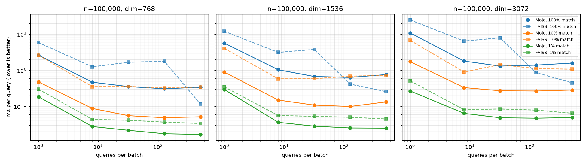

| dim | match | batch 1: Mojo / FAISS ms | batch 32 | batch 512 |
|---|---|---|---|---|
| 1536 | 100% | 5.66 / 12.0 | 0.67 / 3.78 | 0.76 / 0.26 |
| 1536 | 10% | 0.89 / 4.04 | 0.11 / 0.59 | 0.13 / 0.72 |
| 1536 | 1% | 0.29 / 0.35 | 0.028 / 0.053 | 0.025 / 0.045 |
| 3072 | 100% | 10.8 / 24.8 | 1.31 / 7.92 | 1.58 / 0.45 |
| 3072 | 10% | 1.73 / 6.75 | 0.27 / 1.43 | 0.29 / 1.07 |
| 3072 | 1% | 0.27 / 0.51 | 0.049 / 0.085 | 0.049 / 0.065 |

- Mojo wins every filtered case and every unfiltered case up to batch 32.
- FAISS (BLAS through Accelerate/AMX) wins unfiltered batches of 128 and more.

### Storage

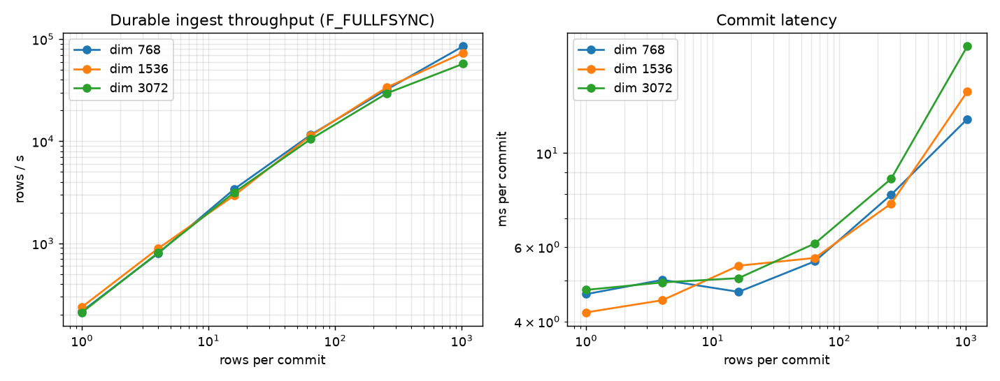

- **Commit:**
  - Every commit pays one `F_FULLFSYNC`, about 4–5 ms on this SSD.
  - Throughput grows almost linearly with rows per commit: about 220 rows/s at 1 row per commit, 30k rows/s at 256, and 57k–85k rows/s at 1024 (705 MB/s at dim 3072).

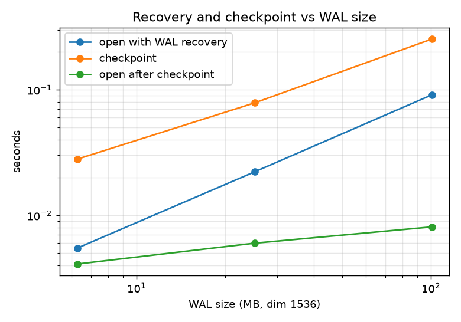

- **Recovery on open:**
  - Replays the WAL at about 1.1 GB/s (91 ms for 100 MB).
  - Opening after a checkpoint takes 4–8 ms.
- **Checkpoint:** 225–400 MB/s, limited by per-row `pwrite` calls.

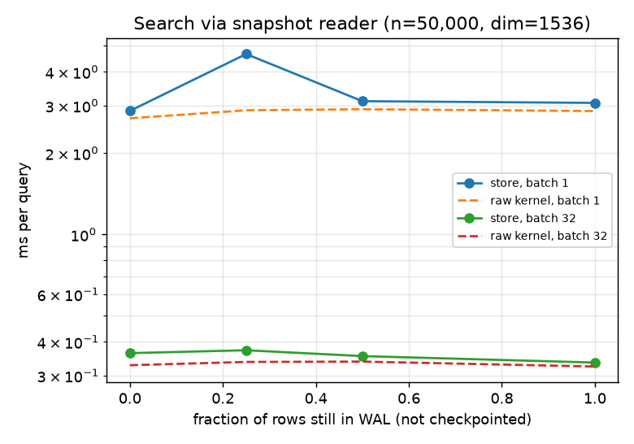

- **Search through a snapshot reader:**
  - Within about 3–10% of the raw kernel on the same rows, whether rows sit in the main file (memory-mapped) or only in the WAL. Single-query samples are noisy; one run measured 4.7 ms vs 2.9 ms.
  - Mapping the file on every search cost 3x at first. The mapping is now kept and only grown.

### Formal checking cost

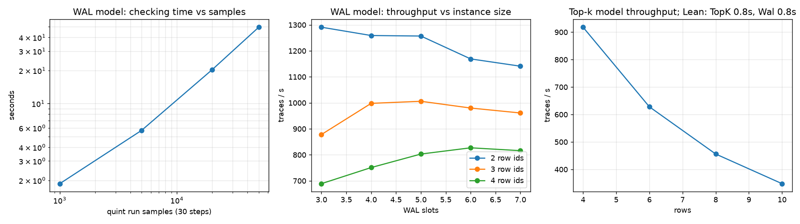

- Quint random simulation of the WAL model runs at about 1,000 traces/s, so time grows linearly with samples (50k samples take 50 s).
- Throughput falls with more row ids, and barely changes with WAL slots.
- Each Lean file checks in under a second.

### Test volume

- `c_host`: 167,565 kernel checks under ASan and UBSan.
- `store_test`, 3,000 seeds x 200 steps: 29.2M checks with 0 failures, including:
  - 7,984 crashes in the middle of an operation and 24,065 crashes while idle;
  - 7,721 WAL restarts and 20,589 recoveries that replayed the WAL over checkpointed rows;
  - 4,853 unacknowledged transactions correctly lost, and 162k reader searches checked against a reference.
- Every kernel mutant and every storage mutant except `NO_CHAIN` is caught. `NO_CHAIN` passing is expected (see the WAL mutant table).

## Status

| # | Question | Verdict |
|---|---|---|
| S1 | Mojo C-ABI library with full validation | **VALIDATED** |
| S2a | Batched CPU exact search, competitive | **VALIDATED** (AMX through BLAS wins large unfiltered batches) |
| S2b | Apple GPU through Mojo | **PARTIAL**: exact (proved selection, bit-exact tests); 1.3–3x faster than the CPU for unfiltered batches of 128+; slower for small or filtered batches; FAISS/AMX still faster at 512 |
| S3 | Filtered batched top-k, formally verified | **VALIDATED** |
| S4 | File format + WAL: crash-safe, snapshot readers, formally modelled | **VALIDATED** within the limits below |
| S5a | float16 storage | **VALIDATED**: half the size, 2x faster from SSD at every batch size, 1.4–1.9x faster single-query in RAM, slower for in-RAM batches; recall 0.999+ |
| S5b | int8 with provably exact rescoring | **INVALIDATED and removed** (tag `int8-exact-experiment`): correct but slower than float32 |

### Limits and gaps

- **Single process, single-threaded API.** Readers interleave with the writer but don't run on other threads. There is no multi-process locking or shared memory index yet.
- **Directory not synced.** The parent directory isn't `fsync`ed after the files are created.
- **Crash simulation assumes independence.** Sector independence is modelled; misdirected writes and bit rot are only partly covered, by checksums.
- **Checksum is not cryptographic.** It's a 64-bit hash, so `Agrees` holds with high probability, not with certainty.
- **Fixed-size frames.** Deletes carry an unused vector-sized payload.

### Surprises

- **ASAP destruction freed buffers too early.** Mojo frees a `List` after its last tracked use, so buffers passed to libc by address were freed before the call finished. The fix is `_ = buf^` keep-alives.
- **`@export` in an imported module is only emitted when it's called.** `scripts/build.sh` concatenates the modules instead.
- **Mapping per search tripled latency.** The mapping is now persistent.
- **Two real durability bugs were found:** one by the model, one by the code tests. Each now has a directed Quint run and a code mutant.

## Run

```
uv venv -p 3.12 .venv && source .venv/bin/activate
uv pip install mojo==1.2.0 max==26.7.0 numpy faiss-cpu matplotlib
scripts/check.sh && scripts/check-formal.sh
python -I bench/bench_store.py && python -I bench/sweep_kernel.py 100000 && python -I bench/sweep_dtype.py 100000 && python -I bench/bench_ssd.py 4 1536,3072 && python -I bench/bench_formal.py && python -I bench/plots.py
```
